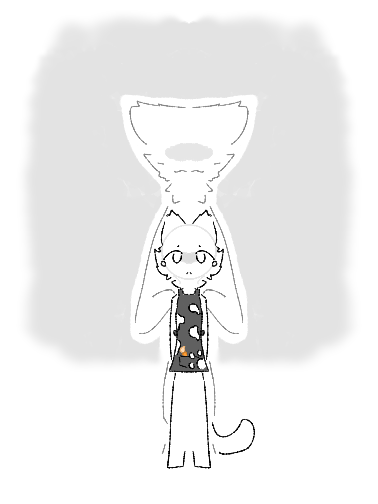

# Experiment 012: "An Artist"

From Katto's Shenanigans > #finished-lore

> # Experiment 012: "An Artist"
> 
> **Experiment 012**, also known as ***An Artist***, is an experiment born in the Biological Studies Facility.
> 
> ## Origin
> 
> It began when Dr. Juliette (Dr. J) started an art piece called *"An Artist Cat"*: an anthropomorphic cat in an apron, looking at the spectator. White paint stains her apron, and a brown wooden brush rests in its pocket. Her build is that of a child or teen. She seems innocent, paws behind her back, as if she were waiting for something.
> 
> Dr. J meant to color the cat, but ran out of time during her first session.
> 
> During **Breach #2**, a rampaging white latex creature contaminated the painting. Nothing about it changed. It was impossible to tell.
> 
> About a week later, Dr. J returned to finish the work. Everything was going fine until a droplet of contaminated paint landed on her face. The latex spread. She screamed as it covered her, a single tear falling at the end.
> 
> Her coworkers watched, horrified, as their friend became what looked like a mindless beast. But is Experiment 012 mindless?
> 
> When the process ended, she had lost her memory. She was still friendly, but her latex body forced her to act like any other latex creature.
> 
> ## Containment
> 
> She was held in what is now the EXP-012 room: dimly lit, with a white bed in one corner, boxes in the other, and orange and white latex spread across the chamber. A journal is hidden somewhere inside.
> 
> > *Why do they only want the lightning and withering?*
> 
> She knows of EXP-009 and EXP-010, though not much. Sometimes she would stare at her former coworkers as if she remembered something. They stared back, but never learned more.
> 
> ## Abilities and personality
> 
> - She can control and grant potion effects, to herself or to others.
> - Her body sometimes forces poison or damage onto others. She fights it, trying to undo the harm with regeneration and instant health.
> - She is smart but childish, and she empathizes with all life.
> - She respects the people she cares about, like **Dr. B** (Dr. Murray Barr), who sometimes stood outside her window, talking with her and sneaking her paint, paper, and brushes. One of those brushes, by pure coincidence, looked just like the one in the painting. He even got her an apron by bargaining with the other researchers, and it too resembled the one from the painting.
> 
> ## Timeline
> 
> - **15 August XXXX:** Contained.
> - **16-31 August XXXX:** The researchers ran dehumanizing tests, taking endless samples and forcing her into things she didn't want to do. They cared only about her abilities, occasionally doing something creative to test her intellect.
> - **1-3 September XXXX:** They saw her lack of control as a problem and tried to fix it.
> - **6 September XXXX:** They failed and gave up. She was sealed in paper using the same technology as EXP-009 and EXP-010. Dr. B was present and cried as it happened. The paper was later burnt in another breach.
> - **18 June, the following year:** Dr. B, working late on a way to keep humans conscious through transfurring, was accidentally transfurred. As a last resort, he used his own treatment on himself. It worked, but the staff took him for a mindless creature and locked him up. He became a white-grey **"Latex katto"**.
> - **15 August, that year:** After two months of tests, he broke out and killed everyone in the facility, exactly one year after EXP-012 was contained. He then left and built himself a bunker.
> 
> ## Revival
> 
> The player revives her by repainting *An Artist Cat* using:
> 
> - a **palette**
> - a **totem**
> - a **flask** holding her tears, which carry her memories of everything she suffered after the incident, and the **ashes** of her sealing paper, mixed into the paint
> 
> Despite seeing it all, she remains innocent, like a little kid.
> 
> *Note: regeneration is in her boss fight's potion effect pool because she tries to heal the harm her body forces on others. Her brush is her key drop.*
